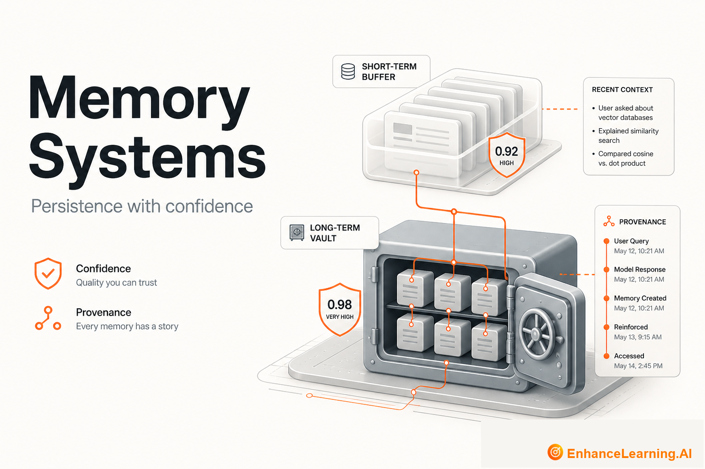

  

# Memory Systems: Persistence, Confidence, and Trust in AI Products

> Maintained reading path from [EnhanceLearning.AI](https://enhancelearning.ai) — practitioner-grade articles for engineers, architects, and technology leaders building production AI-native systems.

**Topic on the site:** [Memory Systems](https://enhancelearning.ai/articles?category=Memory+Systems) · **Full library:** [enhancelearning.ai/articles](https://enhancelearning.ai/articles)

## What this repo is

A curated reading path for **Memory Systems**. It is not a code SDK — it points to the foundation deep-dives on [EnhanceLearning.AI](https://enhancelearning.ai) so you can align on concepts, critique designs, and ship production systems that hold up.

Explore AI memory fundamentals, consolidation challenges, confidence scores, caching vs memory, and the operational problems that appear once agents can write state back into your systems.

## Who it's for

Engineers building agents, personalization systems, or long-running AI workflows that need durable state.

## Foundation articles

- [AI Memory Systems Explained](https://enhancelearning.ai/articles/ai-memory-systems-explained) — How short-term, long-term, episodic, and semantic memory work in AI agents — and how they differ from RAG when assembling a production context window.
- [Context vs Memory in LLM Systems](https://enhancelearning.ai/articles/context-vs-memory-in-llm-systems) — Context is what you pack into this call. Memory is what you choose to keep across calls. Draw that boundary before your window becomes a junk drawer.
- [Caching vs Memory in AI Systems: Speed isn’t Continuity](https://enhancelearning.ai/articles/caching-vs-memory-in-ai-systems) — Caches speed up repeated work. Memory preserves meaning about users and cases. Mixing the two creates stale answers and false continuity.
- [Why AI Memory is Harder to Get Right Than Retrieval](https://enhancelearning.ai/articles/why-ai-memory-is-harder-to-get-right-than-retrieval) — Retrieval looks up what exists. Memory decides what to write, merge, trust, and forget. That write path is where production agents quietly fail.
- [Why Memory Consolidation is the Central Challenge in AI Memory Design](https://enhancelearning.ai/articles/why-memory-consolidation-is-the-central-challenge-in-ai-memory-design) — Storing observations is easy. Merging them into coherent durable state without duplication or corruption is the hard problem agents keep rediscovering.
- [Why AI Memory Needs Confidence Scores, Not Just Facts](https://enhancelearning.ai/articles/why-ai-memory-needs-confidence-scores-not-just-facts) — Agents reason over imperfect extracts. Store confidence and provenance with every memory item or you will treat guesses as ground truth.
- [Explicit vs Implicit Memory Formation in AI](https://enhancelearning.ai/articles/explicit-vs-implicit-memory-formation-in-ai) — Explicit memory is what users or systems deliberately store. Implicit memory is inferred from behavior. Mixing them without labels breaks trust and consent.

## More from EnhanceLearning.AI

- Homepage: [https://enhancelearning.ai](https://enhancelearning.ai)
- All articles: [https://enhancelearning.ai/articles](https://enhancelearning.ai/articles)
- This topic filter: [Memory Systems](https://enhancelearning.ai/articles?category=Memory+Systems)
